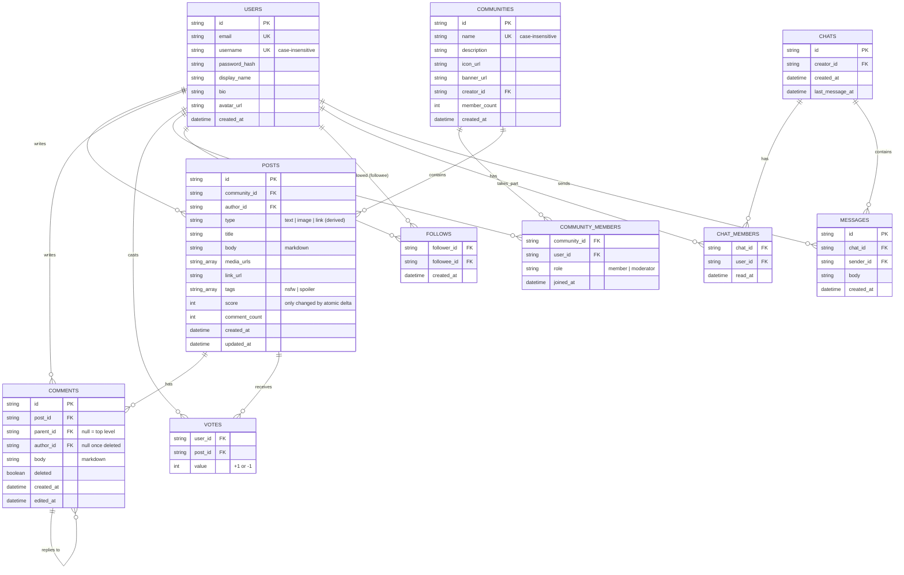

# Database schema (ER diagram)

## Relations
- **users - posts / comments**: one user writes many posts and comments. A deleted comment that still has replies keeps its row (`deleted = true`, `author_id = null`, body `[deleted]`) so the thread stays intact.
- **communities - community_members - users**: many-to-many. `role = moderator` is given to the creator; moderators can remove any post or comment of their community.
- **comments - comments**: self relation through `parent_id`, so replies nest without a depth limit.
- **votes**: one row per (user, post). The post `score` is changed only by the delta of a vote, never recomputed in application code.
- **follows**: directed edge follower -> followee. "People you may know" and the Following feed are built from it.
- **chats - chat_members - users**: a chat has two or more members (more than two = group chat). `read_at` per member gives the unread count. In the mock database the members are stored as an array inside the chat; in Mongo/SQL use this table.

## Indexes
| Index | Why |
|---|---|
| `users.email` UNIQUE, `users.username` UNIQUE (case-insensitive collation) | no duplicate accounts, fast login and username check |
| `communities.name` UNIQUE (case-insensitive) | `r/name` URLs are unique |
| `community_members (community_id, user_id)` UNIQUE | joining twice is a no-op; fast "is member" check |
| `votes (user_id, post_id)` UNIQUE | **at most one vote per user per post**, even when requests race |
| `posts (community_id, created_at DESC, id DESC)` | community feed, New sort, keyset pagination |
| `posts (score DESC, id DESC)` | Top sort |
| `posts (author_id, created_at DESC)` | profile Posts tab, Following feed |
| `comments (post_id, parent_id)` | load a thread and its replies |
| `follows (follower_id, followee_id)` UNIQUE, `follows (followee_id)` | follow idempotency, followers list |
| `chat_members (chat_id, user_id)` UNIQUE, `chat_members (user_id)` | my chats |
| `messages (chat_id, created_at DESC)` | load the latest messages, page back in time |