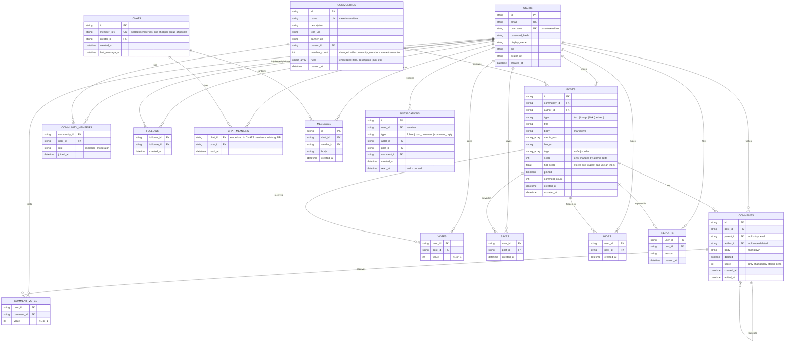

# Database schema (ER diagram)

## Relations
- **users - posts / comments**: one user writes many posts and comments. A deleted comment that still has replies keeps its row (`deleted = true`, `author_id = null`, body `[deleted]`) so the thread stays intact.
- **communities - community_members - users**: many-to-many. `role = moderator` is given to the creator; moderators can remove any post or comment of their community.
- **comments - comments**: self relation through `parent_id`, so replies nest without a depth limit.
- **votes**: one row per (user, post). The post `score` is changed only by the delta of a vote, never recomputed in application code.
- **follows**: directed edge follower -> followee. "People you may know" and the Following feed are built from it.
- **chats - chat_members - users**: a chat has two or more members (more than two = group chat). `read_at` per member gives the unread count. In MongoDB the members are embedded in the chat (`members: [{ userId, readAt }]`) because a chat has few members and they are always read with it; `memberKey` (sorted member ids, unique) guarantees one chat per group of people.

- **comment_votes**: one row per (user, comment), same atomic design as votes.
- **notifications**: one row per event for the receiver; `read_at = null` means unread.
- **saves / hides / reports**: one row per (user, post) each. Hidden posts are left out of the viewer's feeds; reports are shown to the community's moderators.
- **Deleting a post** removes its comments, votes, comment votes, saves, hides and reports in one transaction (MongoDB has no foreign keys or ON DELETE CASCADE).

## Indexes
| Index | Why |
|---|---|
| `users.email` UNIQUE, `users.username` UNIQUE (case-insensitive collation) | no duplicate accounts, fast login and username check |
| `communities.name` UNIQUE (case-insensitive) | `r/name` URLs are unique |
| `community_members (community_id, user_id)` UNIQUE | joining twice is a no-op; fast "is member" check |
| `votes (user_id, post_id)` UNIQUE | **at most one vote per user per post**, even when requests race |
| `posts (community_id, created_at DESC, id DESC)` | community feed, New sort, keyset pagination |
| `posts (community_id, hot_score DESC, id DESC)`, `posts (community_id, score DESC, id DESC)` | community feed, Hot/Best and Top |
| `posts (created_at DESC, id DESC)`, `posts (hot_score DESC, id DESC)`, `posts (score DESC, id DESC)` | front page, all sorts |
| `posts (author_id, created_at DESC)` | profile Posts tab, Following feed, karma |
| `posts (community_id, pinned)` partial (pinned only), `posts (media_urls)` | pinned posts; "is this upload still used?" |
| `comments (post_id, parent_id)`, `comments (parent_id)`, `comments (author_id)` | load a thread and its replies, "has replies?", profile comments |
| `comment_votes (user_id, comment_id)` UNIQUE | at most one vote per user per comment |
| `follows (follower_id, followee_id)` UNIQUE, `follows (followee_id)` | follow idempotency, followers list |
| `chats (member_key)` UNIQUE, `chats (members.user_id)` | one chat per group of people, my chats |
| `messages (chat_id, created_at DESC, id DESC)` | load the latest messages, page back in time |
| `notifications (user_id, created_at DESC, id DESC)`, `notifications (user_id, read_at)` | notification list, unread count |
| `saves`, `hides`, `reports (user_id, post_id)` UNIQUE + `(post_id)` | save/hide/report once; cascade delete |

All indexes are declared in `server/src/repositories/mongo/models.js` and created when the server starts. In MongoDB the fields use camelCase (`createdAt`, `authorId`, `hotScore`) and `id` is stored as `_id`.
